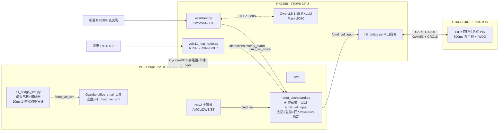

<div align="center">

# 🤖 具身智能巡检机器人
### Embodied Intelligent Patrol Robot

**PC + RK3588 + STM32F407 三级异构巡检安防系统**

[](https://docs.ros.org/en/humble/)
[](https://ubuntu.com/)
[](https://docs.nav2.org/)
[](https://github.com/airockchip)
[](#-离线语音全栈)
[](#-hil-硬件在环闭环)

**自主导航 · 视觉安防 · 语音对话 · 硬件在环 · 多重安全仲裁**

[演示视频](#-演示视频) ·
[系统架构](#-系统架构) ·
[核心能力](#-核心能力与实测数字) ·
[快速开始](#-快速开始最小复现) ·
[部署指南](docs/DEPLOY.md) ·
[踩坑精选](#-踩坑精选)

</div>

---

## 📺 演示视频

> 全部在 **Gazebo HIL 闭环** 中录制：Gazebo 里的小车由 **STM32 真实 1kHz PID 固件** 经串口协议驱动——仿真世界里跑的是真代码。
> 画面布局：左上 Gazebo 物理世界 / 左下 RViz（地图+粒子云+路径）/ 右侧 PyQt 总控台 + 双终端（左：LLM&语音，右：系统&视觉&Nav2）。
> 若个别网络环境下视频加载不出，可直接打开 [`video/`](video/) 目录下的同名文件观看。

### 1️⃣ 手动速度指令与安全急停（16s）

<video src="https://github.com/Telepath-LXR/robot-patrol-system/raw/main/video/01_velocity_command.mp4" controls="controls" poster="https://github.com/Telepath-LXR/robot-patrol-system/raw/main/video/poster/01.jpg"></video>

**看点**：
- Dashboard 下发线速度 `-0.2 m/s` → 右侧终端可见 0x01 帧 `v_l=-0.20, v_r=-0.20` 持续流向 STM32，Gazebo 小车倒车
- 点击「紧急停车」→ 急停锁存 → 日志打出 `【PC端强制刹车】定时器触发！强制向 Gazebo 发 0 速！`——**100Hz 强塞零速兜底**，车停死
- 这条链路同时演示了 `/cmd_vel_input` 唯一出口与"主动发零速而非沉默"的安全哲学

### 2️⃣ 离线语音助手「小A」（37s）

<video src="https://github.com/Telepath-LXR/robot-patrol-system/raw/main/video/02_voice_assistant.mp4" controls="controls" poster="https://github.com/Telepath-LXR/robot-patrol-system/raw/main/video/poster/02.jpg"></video>

**看点**（全程无网络，全在 RK3588 本地）：
- "苹果" 唤醒 → "现在几点？" → TTS 播报当前时间（intent=datetime）
- "内存还剩多少？" → LLM 耗时 3.2s，意图识别命中 `{'mem','disk'}` → **先采 `/proc` 真实数据注入 prompt**，回答"内存使用率 54%，剩余空间 33.5GB"——状态注入反幻觉，模型只复述不编造
- "四川在哪儿？" → 常识问答；语音打断、唤醒词容错（小安/小欸/小阿 同音全覆盖）
- 链路：KWS（sherpa-onnx Zipformer）→ ASR（SenseVoice int8）→ LLM（Qwen2.5-1.5B w8a8 RKLLM，Flask :8080）→ TTS（MeloTTS 24kHz）

### 3️⃣ Nav2 语音导航（69s）

<video src="https://github.com/Telepath-LXR/robot-patrol-system/raw/main/video/03_nav2_navigation.mp4" controls="controls" poster="https://github.com/Telepath-LXR/robot-patrol-system/raw/main/video/poster/03.jpg"></video>

**看点**：
- "苹果" → "导航到大门" → 语音端发布目标点 `x=0.142, y=4.37` → TTS "收到，正在前往大门"
- RViz 中全局路径实时规划，小车沿路径行驶；右终端 hil_bridge 0x01 帧冲到 `v_l=1.63, v_r=1.37`（1.5 m/s 高速段）
- 中途改口 "导航到沙发" 无缝换目标；"停下" → `/voice_estop` 锁存急停
- AMCL 初始位姿由 Dashboard 定时器自动注入（协方差 0.25/0.25/0.0685），全程无需人工点 RViz

### 4️⃣ 巡航模式 · 行人检测刹车（39s，旁白解说）

<video src="https://github.com/Telepath-LXR/robot-patrol-system/raw/main/video/04_cruise_pedestrian.mp4" controls="controls" poster="https://github.com/Telepath-LXR/robot-patrol-system/raw/main/video/poster/04.jpg"></video>

**看点**：
- 摄像头对准人 → `/detections` 在终端刷屏 → Dashboard 仲裁链第 2 级命中 → **主动发布全零 Twist**，小车停下
- 人离开画面 → **2 秒刹车迟滞**（专治 YOLO 跳帧抖动）→ 自动恢复行驶
- 巡航模式只避让、不报警——与下一条视频形成对照

### 5️⃣ 安防模式 · 入侵处置全流程（90s，旁白解说）

<video src="https://github.com/Telepath-LXR/robot-patrol-system/raw/main/video/05_security_mode.mp4" controls="controls" poster="https://github.com/Telepath-LXR/robot-patrol-system/raw/main/video/poster/05.jpg"></video>

**看点**：
- 切到安防模式后，对着机器人喊 "苹果！前进！助手！"——**小车完全无动于衷**（KWS 分支被整体旁路，安防优先于一切语音指令）
- 摄像头发现人员 → 锁死底盘 + 带红框截图存 `pending_records/` + TTS "发现未授权人员，请进行身份验证" + **免唤醒强制录音 5 秒**
- 不说密码 → 验证失败 → 截图转 `danger_records/`，进入**无限循环报警**"警告，警告，有非法人员闯入"，车停死
- PC 端红灯亮起，人工点击「收到异常」→ 回发 `STOP_ALARM` 解除 → 再进 10 秒冷却防反复触发

### 6️⃣ 安防模式 · 密码验证通过（27s，旁白解说）

<video src="https://github.com/Telepath-LXR/robot-patrol-system/raw/main/video/06_security_auth.mp4" controls="controls" poster="https://github.com/Telepath-LXR/robot-patrol-system/raw/main/video/poster/06.jpg"></video>

**看点**：
- 摄像头对准人员 → 强制录音 5 秒 → 说出密码 "0929"（中文"零九二九"亦可，SenseVoice ITN 双保险）
- TTS "身份验证通过，继续巡检" → 证据图从 `pending_records/` **原子搬移**到 `safe_records/` → 小车恢复巡航
- 每次触发只有**一次**验证机会（`auth_required` 先清位再判定），不给入侵者重试窗口

### 7️⃣ 安防证据链 · 人员记录（36s，旁白解说）

<video src="https://github.com/Telepath-LXR/robot-patrol-system/raw/main/video/07_personnel_records.mp4" controls="controls" poster="https://github.com/Telepath-LXR/robot-patrol-system/raw/main/video/poster/07.jpg"></video>

**看点**：
- 「危险人员记录」：未通过验证者被拍下的带红框现场图（`danger_records/`）
- 「安全人员记录」：通过验证者的存档截图（`safe_records/`），**文件名即拍摄时间戳**
- PC 后台 `scp` 静默回传两套目录，Dashboard 一键打开本地文件夹核查

---

## 🧭 项目简介

这不是一台能跑的 demo 车，而是一套奔着**商用安防机器人骨架**去设计的三级异构系统：

- **巡检场景**：Gazebo 办公室/仓库地图中自主导航巡航，实测最高 **1.5 m/s**，RViz 实时显示 AMCL 粒子云与代价地图
- **安防场景**：YOLO11 在 **23Hz** 检测帧率下发现 `person` 立即锁死底盘、现场截图、TTS 质问、**免唤醒强制录音 5 秒**送离线 ASR 验证密码；验证失败进入无限报警死锁，必须 PC 端人工确认解除
- **HIL 硬件在环**：STM32 跑**真实 1kHz 双轮位置式 PID 固件**，收虚拟编码器注入帧（0x07）、回传真实 PWM（0x08），驱动 Gazebo 里的虚拟小车——**"真固件，假世界"**，Nav2/PID 调参全程零烧车风险

三级分工按实时性分级：**1kHz 的环放 MCU（Linux 做不到硬实时），23Hz 的视觉放 NPU，10Hz 的仲裁与全局决策放 PC**——每块算力都用在它最擅长的时间尺度上。

---

## 🏗️ 系统架构



**三级职责**：

| 层级 | 硬件 | 干什么 | 为什么是它 |
|---|---|---|---|
| 决策大脑 | PC (Ubuntu 22.04) | Gazebo 仿真、Nav2、Dashboard 集中仲裁 | 需要看见全局状态才能仲裁 |
| 边缘大脑 | RK3588 (6 TOPS NPU) | YOLO11 / KWS / ASR / LLM / TTS / 串口网关 | 音视频流不能跨网回传，MCU 又跑不动 |
| 实时小脑 | STM32F407 (FreeRTOS) | 1kHz PID、编码器、看门狗 | 毫秒级确定性只有 MCU 给得了 |

---

## ⚡ 核心能力与实测数字

| 能力 | 实测指标 | 实现位置 |
|---|---|---|
| 自主导航 | max_vel_x=**1.5 m/s**、min_vel_x=-1.0（可倒退）、max_vel_theta=3.0 rad/s、AMCL 2000/500 粒子 | PC Nav2（354 行参数） |
| 视觉安防 | **23Hz** Detection2DArray 跨机接收；640×640；CONF 0.5 / NMS 0.45；RTSP over TCP | RK3588 NPU 单核 |
| 语音对话 | 6 唤醒词 + 7 动作词；6 轮上下文；LLM ~8 token/s（单核 NPU）；TTS 24kHz | RK3588 |
| HIL 闭环 | STM32 真实 1kHz PID 驱动 Gazebo；0x07 编码器注入 10Hz 节流；0x08 PWM 回读；**8 跳延迟 8~21ms** | PC+RK+STM32 三级 |
| 串口协议 | 心跳实测 **100.3ms**（min 100.2/max 100.4），**216/216 全应答零丢失**；CRC16/CCITT-FALSE | RK↔STM32 UART |
| 遥测精度 | /odom **10.000Hz**（std 0.0001）；IMU **49.99Hz**；电压 12.60V | STM32 固件 |
| 安防端到端 | 发现→锁死→截图→质问→录音 5s→验证→归档，链路延迟 **≈236ms**（验收线 <1s） | PC+RK 联动 |
| 实时性验证 | PID 环 DWT 实测抖动 **<50µs**；优先级反转实验 **4954ms→212ms**（互斥锁优先级继承） | STM32 |
| 一键启动 | t=0 Gazebo+HIL 桥+视觉+串口；t=6s Nav2；t=8s RViz；再 8s 自动注入初始位姿 | PC Dashboard |

---

## 🔁 HIL 硬件在环闭环

本项目区别于普通仿真的核心：**Gazebo 里的虚拟小车不是被软件"演"出来的，而是被 STM32 真实固件"开"出来的**。

```
PC Nav2/语音/手动 ──/cmd_vel_input──► RK hil_bridge.py ──0x01 帧──► STM32 真实 1kHz PID
                                                                          │ 算出真实 PWM
PC Gazebo 小车 ◄──/cmd_vel_sim── PC hil_bridge_sim.py ◄──/hil_wheel_cmd ◄─┘ (0x08 回读)
       │
       └──/odom 真值 ──► Bresenham 残差积分反算编码器增量 ──/hil_enc──► RK ──0x07 帧──► 注回 STM32
```

一圈下来，**STM32 的固件不知道自己在开一辆不存在的车**——这正是 "真固件 + 假世界" 的 HIL 定义，对标工业界 dSPACE 流程。它带来的红利：

- Nav2 参数从 0.40 m/s 一路调到 1.5 m/s，所有"飞驰撞墙"都发生在 Gazebo 里，**真车零风险**
- 协议栈（CRC16/8 态机）、PID 整定、安全看门狗在闭环里被反复真实锤炼
- 迁移真车时决策层零改动（见 [真车迁移路线](#-真车迁移路线)）

工程细节：编码器反馈用 **Bresenham 式小数残差保留**防累积漂移；刹车态**照发反馈**（早期 return 掉导致 STM32 积分饱和死锁飞车）；仿真端电机惯性系数拉到 1.0（无惯性），把调参难度全部留给真实控制器——"为迁就真实控制器而降低仿真保真度"的刻意取舍。

---

## 🎛️ 集中仲裁：全车速度的唯一出口

全车速度指令只有一个出口——PC 端 `dashboard_node` 发布的 **`/cmd_vel_input`**。Nav2 的 `/cmd_vel`、语音的 `/cmd_vel_voice`、手动输入全部先汇到仲裁器，10Hz 仲裁循环按优先级裁决：

```
安防警报锁存  >  急停锁存  >  行人刹车（2s 迟滞）  >  Nav2 导航  >  语音/手动
```

两条铁律：

1. **所有"阻断"都是主动发布全零 Twist，绝不"沉默"**——沉默是最危险的信号，零速 Twist 永远比没有消息安全。PC 仲裁器、RK 串口桥（0.5s 超时发零速帧）、`hil_bridge_sim`（100Hz 强塞零速）、STM32（500ms 心跳看门狗清 PWM + 1s IWDG 硬复位）五级同构兜底。
2. **底层执行权与导航算法物理隔离**——URDF 里 `<remapping>cmd_vel:=cmd_vel_sim</remapping>` 让 Gazebo 只认 `/cmd_vel_sim`，Nav2 六个节点就算绕开仲裁直发 `/cmd_vel`，也没有任何执行器理它们。（这是"急停失效"血泪事故换来的核心修复。）

---

## 🔐 安防双模式状态机

巡航模式（见人只刹车不报警）与安防模式（完整入侵处置流程）由 Dashboard 下拉框经 `/system_mode` 切换：

```
安防模式 + 检测到 person（≥0.5）
  → 锁死底盘（仲裁第 0 级）
  → 带红框截图 → pending_records/
  → TTS："发现未授权人员，请进行身份验证"
  → 免唤醒强制录音 5 秒（VAD 旁路，必须录满）
  → SenseVoice 离线识别
     ├─ 命中 "0929"/"零九二九" → 通过 → safe_records/ → TTS 播报 → 10s 冷却
     └─ 未命中 → danger_records/ → 无限循环报警（4.5s 周期）
                 → 唯一解除途径：PC 人工点「收到异常」→ 回发 STOP_ALARM → 10s 冷却
```

关键设计：每次触发**只有一次验证机会**；安防模式下 KWS 全旁路（"停下"都无效）；截图按验证结果 `os.rename` 原子归档；PC 后台 scp 自动回传证据。

---

## 🗣️ 离线语音全栈

`ES8388 麦克风 48kHz → 16kHz → KWS 唤醒 → SenseVoice ASR → Qwen2.5-1.5B（RKLLM）→ MeloTTS → 播报`，全程本地离线：

- **KWS**：sherpa-onnx 流式 Zipformer（3.3M int8），词表为声调拼音音素格式；阈值分级——动作词 2.0 / 唤醒词 2.5 / "停下" 3.0（宁可漏检不可误检）
- **LLM 反幻觉**：命中温度/CPU/内存等 19 类查询时先把 `/proc`、`/sys` 真实数据拼进 prompt（`【系统实测数据：…】`），模型只复述不编造
- **LLM 输出九步清洗**：去代码块/编号/括号/书名号，`/`→"每"（"m/s" 念"米每秒"），60 字句号对齐截断——专治小模型自由发挥
- **功耗墙**：LLM 锁单核 NPU + `max_context_len=1024`（三核全开曾一发请求触发整板电源保护重启）

---

## 🔌 通信协议（PC/RK ↔ STM32）

帧格式：`[0xAA][0x55][TYPE][LEN][DATA(≤32B)][CRC16_H][CRC16_L][0x0D]`

- CRC-16/CCITT-FALSE（多项式 `0x1021`，初值 `0xFFFF`，国际校验向量 `"123456789"→0x29B1`）
- **混合字节序**：payload 一律小端，CRC16 大端传输（踩过两次坑才钉死的规范）
- 解析器为 **8 态逐字节状态机**，与 STM32 C 端逐字节对拍 100% 一致；重同步时复用肇事字节（`AA AA 55` 粘连不丢帧）；CRC 校验先于帧尾，坏帧提前一字节脱困

| TYPE | 方向 | 载荷 | 含义 |
|---|---|---|---|
| 0x01 | ↓ | `<ff` 8B | 左右轮目标速度（m/s） |
| 0x02 | ↑ | `<fff` 12B | 里程计 x/y/θ（10Hz） |
| 0x03 | ↑ | `<f` 4B | 电池电压（12.60V 实测） |
| 0x04 | ↑ | `<ffffff` 24B | MPU6050 六轴（49.99Hz） |
| 0x05 | ↓ | 空 | 心跳（100ms） |
| 0x06 | ↑ | 1B | 心跳应答（payload≠0 即下位机报警，带外通道） |
| 0x07 | ↓ | `<ii` 8B | **HIL 私货**：虚拟编码器增量注入（10Hz 节流） |
| 0x08 | ↑ | `<hhhh` 8B | **HIL 私货**：真实 PWM 回读 |

完整协议规范见 [`firmware/rcc2/docs/protocolv1.0.md`](firmware/rcc2/docs/protocolv1.0.md)。

---

## 📁 目录结构

```
├── pc/                     # PC 端（Ubuntu 22.04 + ROS2 Humble）
│   ├── robot_dashboard.py      # 总控台（583 行）：速度仲裁唯一出口 + 安防 UI + 进程编排（PyQt5）
│   ├── hil_bridge_sim.py       # HIL 虚拟电机/编码器（115 行，100Hz 强塞零速兜底）
│   ├── cyclonedds_pc.xml       # CycloneDDS 单播配置（PC 侧）
│   ├── patrol_description/     # ROS2 包：7-link 极简 URDF + world + 双地图 + Nav2 参数 + launch
│   ├── robot_interfaces/       # 自定义消息（MotorCommand / MotorState）
│   └── tests/                  # 协议对拍测试（双端逐字节 100% 一致）
├── rk3588/                 # RK3588 端（Ubuntu 22.04 + ROS2 Humble + RKNN）
│   ├── yolo11_rtsp_node.py     # RTSP 视觉安防节点（252 行：NPU 推理 + 手写 DFL/NMS + 安防落盘）
│   ├── hil_bridge.py           # HIL 串口桥（129 行：0x07 编码器注入 / 0x08 PWM 回读）
│   ├── cyclonedds_rk.xml       # CycloneDDS 单播配置（RK 侧）
│   ├── robot_serial/           # 实机串口桥包（protocol.py + serial_bridge_node.py 242 行）
│   ├── robot_interfaces/       # 与 PC 同源的消息定义（双机编译 md5 一致）
│   ├── voice/                  # 语音栈：assistant.py + KWS 词表 + LLM Flask 服务
│   └── tests/                  # 串口注入测试（六步剧本）、视觉/语音验证脚本
├── firmware/
│   └── rcc2/                   # STM32F407 最终固件工程（Core + rcc2.ioc + Keil 工程）
│                               # Drivers/ 与 Middlewares/ 由 CubeMX 打开 rcc2.ioc 重新生成
├── deploy/
│   ├── 99-robot-mcu.rules      # udev：PL2303 固定为 /dev/robot_mcu
│   └── 99-robot-pclink.rules   # udev：备用对录串口
├── video/                      # 演示视频（7 段）+ 封面图
├── docs/
│   └── DEPLOY.md               # 分层复现指南 L0~L4（小白从这里开始）
└── scripts/
    └── check_env.sh            # 环境自检脚本（只检查不修改）
```

---

## 🚀 快速开始（最小复现）

> ⚠️ **这个仓不是 clone 下来一键跑的**——它横跨 PC / RK3588 / STM32 三套硬件，依赖模型约 3.5GB。
> **第一次来，请直接看 👉 [`docs/DEPLOY.md`](docs/DEPLOY.md)**：它把复现拆成 L0~L4 五层，从 0 元的纯 PC 仿真开始，每层都有"怎么算跑通了"的判据，强烈建议按层来，不要想着一步全亮。

最快的一步（**L0 纯仿真，0 元**，只要一台 Ubuntu 22.04 电脑）：

```bash
# 装 ROS2 Humble + Nav2 + Gazebo（命令见 docs/DEPLOY.md L0）
mkdir -p ~/ros2_ws/src && cd ~/ros2_ws/src
cp -r <本仓库>/pc/{patrol_description,robot_interfaces} .
cd ~/ros2_ws && source /opt/ros/humble/setup.bash
colcon build --packages-select robot_interfaces && source install/setup.bash
colcon build --packages-select patrol_description && source install/setup.bash

# 三个终端分别：
ros2 launch patrol_description gazebo_sim.launch.py   # 仿真世界
ros2 launch patrol_description nav2_bringup.launch.py  # 导航
rviz2                                                   # 看效果
```

Gazebo 里小车能用 "2D Goal Pose" 指点导航，L0 就通了。

### 一键环境自检

拿不准自己装对没有，跑这个（只检查不修改）：

```bash
bash scripts/check_env.sh
```

在 PC 上跑查 PC 的、在 RK3588 上跑查 RK 的，自动识别。`✗` 必须解决，`!` 看情况。

### 依赖与模型

- PC：`pc/requirements.txt`（rclpy、PyQt5 等；系统级依赖 ROS2 Humble + Gazebo + Nav2）
- RK3588：`rk3588/requirements.txt`（rknn-toolkit-lite2、sherpa-onnx 等）

**模型文件不入库**（约 3.5GB），清单与获取方式见 [`rk3588/README_MODELS.md`](rk3588/README_MODELS.md)：YOLO11 FP16 多头（.rknn）、sherpa-onnx KWS / SenseVoice ASR / MeloTTS、Qwen2.5-1.5B-Instruct RKLLM w8a8。

**第三方 ROS2 包不入库**，请自行 clone 到工作区：
- [m-explore-ros2](https://github.com/robo-friends/m-explore-ros2)（自主探索，可选）
- [gazebo_models_worlds_collection](https://gitee.com/)（Gazebo 离线模型/世界集，配合 `GAZEBO_MODEL_DATABASE_URI=''` 强制离线）

---

## 🕳️ 踩坑精选

50+ 条坑全部有"症状-根因-解法"三段记录，这里只列最有故事性的八条：

| 坑 | 症状 | 根因 → 解法 |
|---|---|---|
| **Nav2 强占 /cmd_vel** | 急停按下小车照跑 | Nav2 六节点绕过仲裁直发 Gazebo → URDF remapping 改 `/cmd_vel_sim`，话题层物理隔离 |
| **INT8 量化血案** | 检测分数 score=2.856 > 1 | 单头模型坐标（数百）与分类（0~1）共用一个量化 Scale，坐标撑爆 Scale 压垮分类 → 换 9 输出多头 + CPU 手写 DFL/NMS |
| **刹车即死锁** | 刹车后 STM32 积分饱和飞车 | 早期代码在刹车分支 return 掉了编码器反馈 → 注释刻碑："绝对核心！不管刹车还是行驶，必须向 STM32 发送编码器反馈" |
| **打开串口 STM32 就死** | 通信永远建立不起来 | PL2303 的 DTR/RTS 接了一键下载电路，open() 电平跳变反复复位 → `setDTR(False); setRTS(False)`（注释：终极硬件修复） |
| **语音峰值 9436 却不唤醒** | KWS 死活不命中 | ES8388 的 ALC 自动增益把语音特征包络压平 → 关 ALC、手动拉满数字增益（硬件"智能"功能是敌非友） |
| **LLM 一发请求整板重启** | RK3588 直接断电复位 | 三核 NPU 瞬时功耗触发电源保护 → 锁单核 + 限上下文 1024（~8 token/s 可用） |
| **晶振乱码血案** | 串口满屏乱码，程序"看起来都对" | CubeMX 默认模板按 25MHz 晶振配 PLLM，板子是 8MHz，SYSCLK 实为 53.76MHz → 固化纪律：先核时钟树，再读 `SystemCoreClock==168000000` |
| **优先级反转** | 高优任务被卡 4954ms | 二值信号量无优先级继承 → 换互斥锁 `osMutexPrioInherit` → 212ms（23 倍） |

---

## 🛣️ 真车迁移路线

HIL 架构从设计之初就把"决策"与"执行"解耦，真车迁移**上层代码一行不用改**：

1. 关掉 Gazebo 与 `hil_bridge_sim.py`（纯仿真组件，整体摘除）
2. RK 串口从 `hil_bridge.py` 切到 `serial_bridge_node`——`hil_mode` 参数一个翻转就是"仿真/真车"总开关
3. 雷达换 RPLIDAR 真实建图，替换 `office_map*.yaml`
4. 重标定三组参数：电机 PWM→轮速系数（仿真里的 ×30.0 是虚拟值）、Nav2 动力学参数、代价地图尺寸参数

PC Dashboard、`assistant.py`、`yolo11_rtsp_node.py` **一行不用改**——它们根本不知道也不关心下游是 Gazebo 还是真电机。

---

## ⚠️ 安全说明

- 代码中的 RTSP 相机凭据、内网 IP 均已脱敏为环境变量或占位符，部署时按实际填写
- 安防密码（0929）为演示功能设计，生产环境请修改 `rk3588/voice/assistant.py` 中的验证逻辑

## 🔧 运维小贴士

- 若遇 `ros2 daemon` 幽灵节点（`ros2 node list` 出现已死节点），执行 `ros2 daemon stop && ros2 daemon start` 清理
- 若 RViz 收不到地图（"No map received"）：`/map` 是 Transient Local（latched）QoS，RViz 的 Map 显示需把 QoS 切到 **Transient Local**

---

<div align="center">
如果这个项目对你有帮助，欢迎 ⭐ Star
</div>
